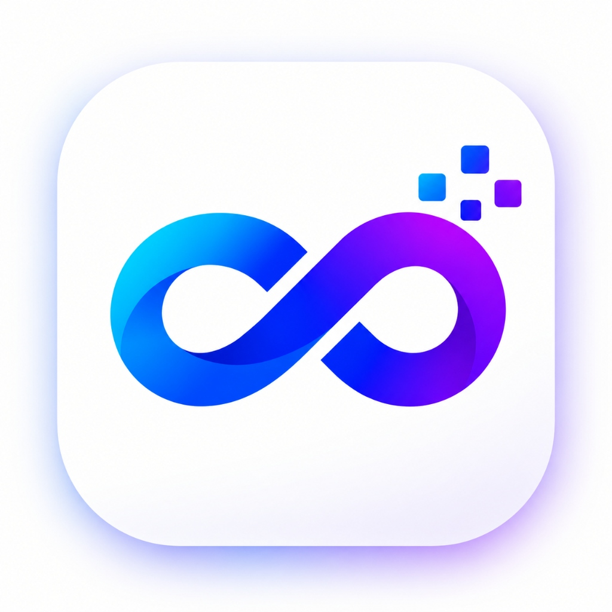

<p align="center">
  
</p>

<p align="center">
  
</p>

<p align="center">
  <strong>Autonomous client-side region adaptation extension for Google Flow.</strong>
</p>

<p align="center">
  <a href="https://angelolockdev.github.io/omniflow/">Official Website</a> •
  <a href="#highlights">Highlights</a> •
  <a href="#features">Features</a> •
  <a href="#installation">Installation</a> •
  <a href="#usage">Usage</a>
</p>

<p align="center">
  
  
  
</p>

---

## Highlights

**OmniFlow** is a lightweight Chromium extension (Manifest V3) built to provide seamless access to [Google Flow](https://flow.google.com) from any region without modifying your Google account country or routing traffic through external VPNs and proxies.

- **Native Connection Speed**: Operates directly inside your browser sandbox with zero bandwidth throttling or proxy relays.
- **Account-Safe**: Leaves your Google account region, workspace profile, and payment settings untouched.
- **Obsidian Control HUD**: Real-time status matrix displaying engine readiness and active tab state at a glance.
- **Zero Build Overhead**: Pure, dependency-free extension ready to load directly in Chromium browsers.

---

## Features

- **Instant Region Adaptation**: Prevents `/unsupported-country` redirects automatically when opening `flow.google.com`.
- **One-Click Protection Switch**: Arm or disarm the engine directly from the extension popup.
- **Live Telemetry HUD**: Real-time indicators (`ACTIVE`, `READY`, `ENABLED`, `DISABLED`, `RELOAD`).
- **Broad Chromium Support**: Compatible with Google Chrome, Brave, Microsoft Edge, Arc, Opera, and Vivaldi.

---

## Installation

### Load Unpacked (Developer Mode)

1. Clone or download this repository:
   ```bash
   git clone https://github.com/angelolockdev/omniflow.git
   ```
2. Open your Chromium browser and navigate to `chrome://extensions`.
3. Enable **Developer mode** using the toggle in the top-right corner.
4. Click **Load unpacked** in the top-left toolbar and select the `omniflow` folder.
5. Pin the **OmniFlow** icon to your browser toolbar.

---

## Usage

1. **Activate Access**: Click the **OmniFlow** icon in your toolbar, enter your access key in the popup, and click **Activate**.
2. **Enable Protection**: Ensure the **Protection Engine** switch is toggled **ON**.
3. **Launch Google Flow**: Click **Open Flow** (or visit [flow.google.com](https://flow.google.com)).
4. **Reload if Needed**: If a Flow tab was already open prior to activation, click **Reload Tab** from the popup.

---

## Links

- **Website**: [https://angelolockdev.github.io/omniflow/](https://angelolockdev.github.io/omniflow/)
- **Repository**: [https://github.com/angelolockdev/omniflow](https://github.com/angelolockdev/omniflow)

---

## License

This project is licensed under the MIT License.
